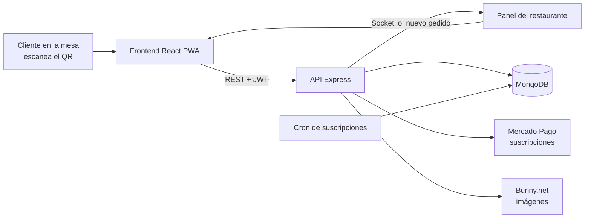

# Menú QR — Menús digitales y pedidos para restaurantes

> 🔒 **El código es privado** porque es un producto comercial. Para procesos de selección puedo
> dar acceso de lectura al repositorio o mostrarlo en una llamada: escribime (ver
> [Contacto](#contacto)).

SaaS de menús digitales. El restaurante arma su carta desde un panel, imprime un QR por mesa y
los clientes ven el menú y piden desde el celular. Los pedidos llegan a la cocina **en tiempo
real**.

<!-- TODO: agregar capturas en media/ y descomentar

  
  

-->

**Demo:** _(agregar link)_

## Funcionalidades

**Para el cliente del restaurante**
- Menú con la marca del local (colores, logo y fotos), categorías y productos.
- Pedido desde la mesa, que llega al instante al panel.

**Para el restaurante**
- Constructor de menú con arrastrar y soltar.
- Mesas con su QR listo para imprimir.
- Panel de pedidos en tiempo real.
- Varias sucursales con ubicación en mapa.
- Exportación de la carta a PDF.
- Estadísticas de visitas y pedidos.

**Negocio**
- Suscripción mensual con Mercado Pago y control automático de vencimientos.
- Panel de superadministrador para gestionar restaurantes, usuarios y demos.
- Landing page con modo demo.

## Arquitectura

## Stack

| Capa      | Tecnología                                                                  |
| --------- | --------------------------------------------------------------------------- |
| Frontend  | React · Vite · Tailwind CSS · HeroUI · Zustand · React Hook Form · Recharts |
| Backend   | Node.js · Express · MongoDB + Mongoose · Socket.io · Zod · node-cron        |
| Servicios | Mercado Pago · Bunny.net · Leaflet (mapas) · React PDF                      |

## Seguridad

- Autenticación con JWT en cookies y contraseñas con bcrypt.
- Helmet, CORS restringido, límite de peticiones y validación con Zod.
- Validación del tipo real de las imágenes subidas, no solo de la extensión.

## Lo que aprendí

- Comunicación en tiempo real con WebSockets separada por restaurante.
- Construir un producto SaaS completo: landing, demo, cobro y panel de administración.

## Contacto

- LinkedIn: [linkedin.com/in/alejofre](https://www.linkedin.com/in/alejofre/)
- Email: [alejandrojofre949@gmail.com](mailto:alejandrojofre949@gmail.com)
